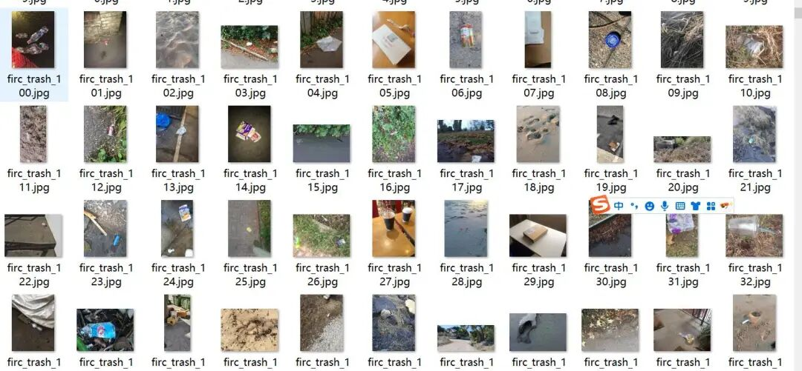
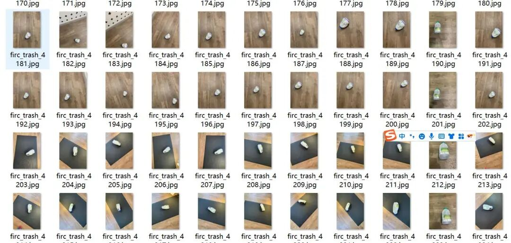
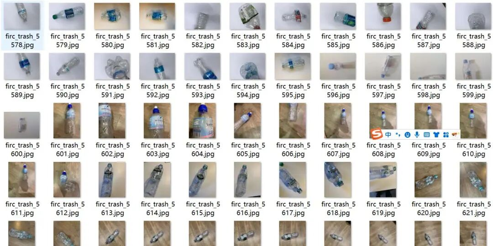
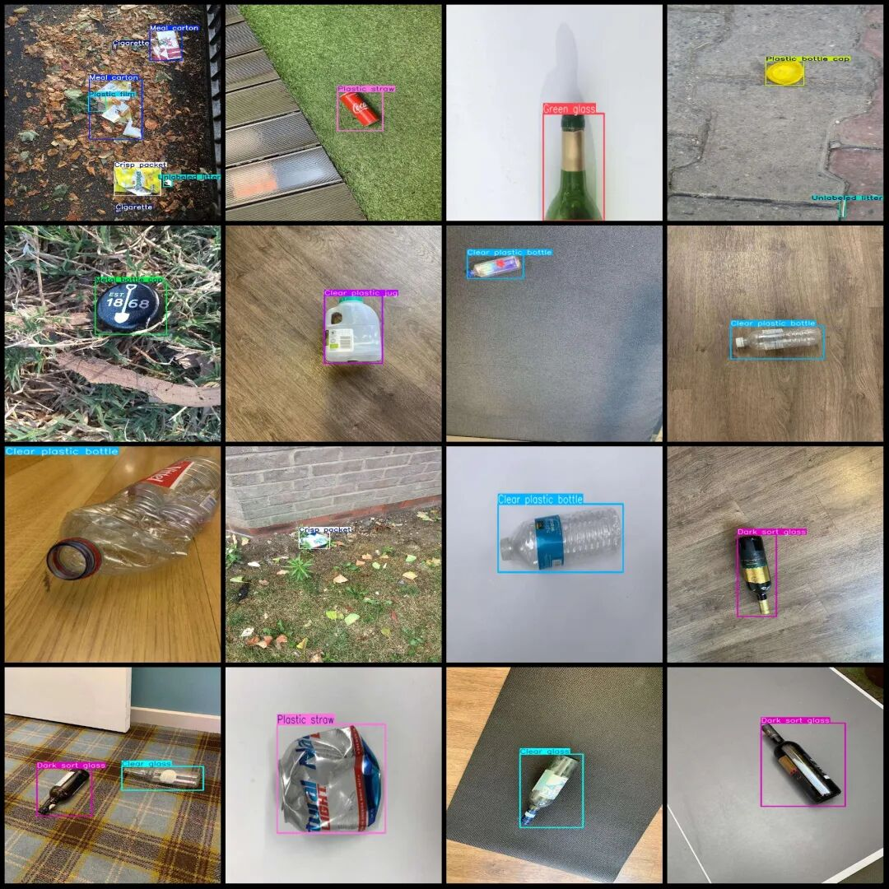

# Dataset of drone-view road trash detection in VOC+YOLO format with 6232 images and 64 categories

Note: The dataset targets are drone close-up photography.

Dataset format: Pascal VOC format + YOLO format (txt file without split path, only contains jpg images and corresponding VOC format xml files and yolo format txt files)

Number of images (number of jpg files): 6232

Number of annotations (number of xml files): 6232

Number of annotations (number of txt files): 6232

Label count: 64

Label category names(NoteyoloThe format category order does not correspond to this, but instead...labelsFolderclasses.txtPrecision):["Aerosol","Aluminium blister pack","Battery","Broken glass","Brown glass","Carded blister pack","Cigarette","Clear glass","Clear plastic bottle","Clear plastic jug","Colored plastic jug","Corrugated carton","Crisp packet","Dark sort glass","Disposable food container","Disposable plastic cup","Drink can","Drink carton","Egg carton","Foam cup","Foam food container","Food Can","Food waste","Garbage bag","Glass cup","Glass jar","Green glass","Magazine paper","Meal carton","Metal bottle cap","Metal lid","Normal paper","Other carton","Other plastic","Other plastic bottle","Other plastic container","Other plastic cup","Other plastic wrapper","Paper bag","Paper cup","Paper straw","Pizza box","Plastic bottle cap","Plastic film","Plastic glooves","Plastic lid","Plastic straw","Plastic utensils","Polypropylene bag","Pop tab","Rope - strings","Scrap metal","Shoe","Single-use carrier bag","Six pack rings","Spread tub","Squeezable tube","Styrofoam piece","Tissues","Toilet tube","Tupperware","Unlabeled litter","Wrapping paper","json"]

Number of boxes labeled in each category:

Aerosol (aerosol can) frame count = 10

Aluminium blister pack (aluminium plastic blister packaging) frame count = 6

Battery (Battery) Frame count = 2

Number of broken glass (broken glass) frames = 143

Number of frames in brown glass (162)

Frame count = 1

Cigarette (tobacco) frame count = 667

Clear glass (transparent glass) frame count = 474

Clear plastic bottle (transparent plastic bottle) frame count = 1707

Clear plastic jug (transparent plastic pot) frame count = 178

Colored plastic jug (Colored plastic pot) Frame count = 839

Corrugated carton (wavy cardboard box) frame count = 65

Crisp packet (potato chip bag) frame count = 39

Dark sort glass (dark glass) frame count = 457

Disposable food container (one-time meal box) frame count = 38

Disposable plastic cup (one-time plastic cup) frame count = 104

Drink can (beverage can) frame count = 229

Drink carton (beverage carton) frame count = 45

Egg carton (egg box) frame count = 11

Foam cup (Foam cup) Frame count = 13

Foam food container (bubble meal box) frame count = 15

Food Can (Food can) Frame count = 34

Food waste (kitchen waste) box count = 8

Garbage bag (Trash bag) Frame count = 31

Glass cup (Glass cup) Frame count = 12

Glass jar (Glass jar) Frame count = 107

Green glass (green glass) frame count = 308

Magazine paper (magazine-use paper) frame count = 12

Meal carton (Meal box) Frame count = 30

Frame count = 80

Metal lid (metal cover) frame count = 10

Normal paper (Ordinary Paper) Frames = 82

Other carton (other paper box) frame count = 93

Other plastic (other plastic) Frames = 259

Number of other plastic bottles = 281

Other plastic container (Other plastic containers) Frame count = 50

Number of frames = 6

Other plastic wrapper (other plastic packaging) frame count = 2

Number of paper bags (Paper bag) = 27

Number of paper cups (Paper cup) = 67

Number of frames for Paper Straw (Paper Straw) = 4

Pizza box (pizza box) frame count = 3

Plastic bottle cap (plastic bottle cap) frame count = 209

Plastic film (plastic film) Frame count = 451

Plastic glooves (Plastic glove) Frame count = 4

Plastic lid (plastic cap) frame count = 77

Plastic straw (Plastic straw) Frame count = 1280

Plastic utensils (plastic tableware) frame count = 37

Polypropylene bag (polypropylene bag) frame count = 3

Pop tab (Ring) box count = 99

Rope - strings (Ropes) Frame count = 29

Scrap metal (metal scraps) frame count = 20

Shoe (Shoes) Frame count = 7

Single-use carrier bag (single-use handbag) frame count = 61

Six pack rings (six-pack ring) frame count = 5

Spread tub (applying box) frame count = 9

Squeezable tube (Hose) Frame Count = 7

Styrofoam piece (foam plastic block) frame count = 112

Tissues (paper towels) Frames = 42

Toilet tube (trash core) frame count = 5

Tupperware (Freezer box) Frame count = 4

Unlabeled litter (unclassified waste) frame count = 516

Wrapping paper (Packing paper) Frame count = 12

JSON (paper ball) frame count = 62

Total frame count: 9762

Image resolution: Multi-resolution, such as 1920x1440, 1920x2560, etc.

Using labelImg:

Drone: DJI MAVIC 3

Collection height: 1-5m

Sampling angle: 30-90°

Annotation rules: Draw a rectangle around the category.

Important Notice: No

Application fields: Smart sanitation, environmental monitoring, AI inspection, etc., roadside garbage, etc.

Special : This dataset does not guarantee the accuracy of the trained models or weight files.

Image Preview:

Annotation example:

## Payment

Here is a pay link on Stripe ( https://buy.stripe.com/3cs8yP7sY87d0vu9AB ). Please contact me lonlonago@foxmail.com after funding $89, and I will send you a complete data files , thank you!

